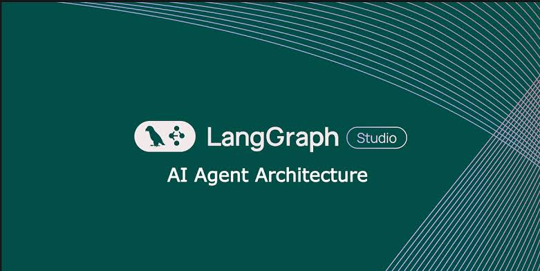

# LangGraph: From Basics to Advanced Agentic AI

[](https://www.python.org/)
[](https://www.langchain.com/langgraph)
[](https://www.langchain.com/)
[](https://ai.google.dev/)
[](https://jupyter.org/)
[](https://www.trychroma.com/)
[](./LICENSE)

<p align="center">
  
</p>

A practical, notebook-based learning path for building stateful workflows and agentic applications with LangGraph. Start with graph structure and typed state, then progress through memory, tools, routing, reliability patterns, multi-agent collaboration, human review, custom tool schemas, and retrieval-augmented generation (RAG).

> The examples are educational notebooks. Some use APIs that have changed across LangChain and LangGraph releases; check the current documentation when adapting them to a new environment.

## Contents

- [What you will learn](#what-you-will-learn)
- [Learning path](#learning-path)
- [Repository layout](#repository-layout)
- [Requirements and setup](#requirements-and-setup)
- [Configuration and API keys](#configuration-and-api-keys)
- [How to use the notebooks](#how-to-use-the-notebooks)
- [Topics covered](#topics-covered)
- [Troubleshooting](#troubleshooting)
- [Contributing](#contributing)
- [License](#license)
- [Connect with me](#connect-with-me)

## What you will learn

LangGraph lets you model an application as a graph: nodes perform work, edges choose what runs next, and shared state carries information through the workflow. Unlike a simple one-way chain, a graph can branch, loop, pause for input, and coordinate multiple agents.

By working through this repository, you can learn to:

- Define graph state with `TypedDict` and validate structured data with Pydantic.
- Build and compile graphs with nodes, edges, and conditional routing.
- Keep conversational context and pass information between workflow steps.
- Connect language models and tools to graph workflows.
- Add planner/executor flows, retries, fallbacks, and guardrails.
- Split work across collaborating agents and subgraphs.
- Incorporate a human review step into a workflow.
- Build a basic document retrieval and question-answering pipeline.

## Learning path

Work through the numbered folders in order. Each folder contains a topic notebook; the RAG section also contains a sample PDF document used by its notebook.

| Step | Topic | Main ideas |
|---|---|---|
| 1 | [Core structure, state, edges, nodes, and graphs](<./01-core-graph/>) | `StateGraph`, graph flow, nodes, edges, and entry/finish points |
| 2 | [Typed state and input/output](<./02-typed-state/>) | `TypedDict`, Pydantic `BaseModel`, and state typing |
| 3 | [Conversation memory](<./03-conversation-memory/>) | Conversation buffer and summary memory patterns |
| 4 | [Tools and tool input schemas](<./04-tools/>) | Tool use, tool nodes, and external search tools |
| 5 | [Planner and executor agents](<./05-planner-executor/>) | Task planning, delegation, and execution |
| 6 | [Tool router agents](<./06-tool-routing/>) | Tool selection and conditional routing |
| 7 | [Retries, fallbacks, and guardrails](<./07-reliability-patterns/>) | Error handling and recovery patterns |
| 8 | [Multi-agent collaboration](<./08-multi-agent/>) | Subgraphs and cross-agent state |
| 9 | [Human-in-the-loop workflows](<./09-human-in-the-loop/>) | Human input, review, and manual overrides |
| 10 | [Global and agent memory](<./10-agent-memory/>) | Agent memory and shared context |
| 11 | [Custom tool typing and schemas](<./11-custom-tool-schemas/>) | Pydantic validation and custom `BaseTool` schemas |
| 12 | [RAG with documents and Chroma](<./12-rag-chroma/>) | PDF loading, chunking, embeddings, vector search, and retrieval |

## Repository layout

```text
.
|-- README.md
|-- LICENSE
|-- banner.png
|-- 01-core-graph/
|   `-- 01-core-graph.ipynb
|-- 02-typed-state/
|   `-- 02-typed-state.ipynb
|-- 03-conversation-memory/
|   |-- 03-conversation-buffer.ipynb
|   `-- 03-conversation-summary.ipynb
|-- 04-tools/
|   `-- 04-tools.ipynb
|-- 05-planner-executor/
|   `-- 05-planner-executor.ipynb
|-- 06-tool-routing/
|   `-- 06-tool-routing.ipynb
|-- 07-reliability-patterns/
|   `-- 07-reliability-patterns.ipynb
|-- 08-multi-agent/
|   `-- 08-multi-agent.ipynb
|-- 09-human-in-the-loop/
|   `-- 09-human-in-the-loop.ipynb
|-- 10-agent-memory/
|   `-- 10-agent-memory.ipynb
|-- 11-custom-tool-schemas/
|   `-- 11-custom-tool-schemas.ipynb
`-- 12-rag-chroma/
    |-- 12-rag-chroma.ipynb
    `-- data.pdf
```

Each numbered topic folder contains one or more Jupyter notebooks. The conversation memory section includes separate buffer and summary examples. Folder and notebook names use a consistent numbered format so the course sequence is easy to browse.

## Requirements and setup

- Python 3.10 or newer is recommended.
- Jupyter Notebook or JupyterLab.
- API credentials for the model or search services used by the notebook you want to run.
- Internet access for installing packages, downloading embedding models, and calling hosted services.

### 1. Clone the repository

```bash
git clone https://github.com/Md-Emon-Hasan/LangGraph-Framework-Basic-to-Advanced.git
cd LangGraph-Framework-Basic-to-Advanced
```

### 2. Create and activate a virtual environment

**Windows PowerShell**

```powershell
py -m venv .venv
.venv\Scripts\Activate.ps1
```

**macOS / Linux**

```bash
python3 -m venv .venv
source .venv/bin/activate
```

### 3. Install the notebook and project libraries

The notebooks use LangGraph and selected LangChain integrations. Install the libraries needed for the lessons you plan to run:

```bash
python -m pip install --upgrade pip
python -m pip install jupyter langgraph langchain langchain-core langchain-community langchain-google-genai python-dotenv pydantic chromadb pypdf sentence-transformers tavily-python wikipedia
```

These are unpinned package names, not a tested lockfile. LangChain integrations evolve, and older notebook examples may need small code changes with recent releases. For reproducible projects, pin the versions you validate in your own environment.

### 4. Start Jupyter

```bash
jupyter notebook
```

Open a numbered folder, then run its notebook from top to bottom. Begin with step 1 if this is your first time using LangGraph.

## Configuration and API keys

Several lessons call hosted services, including Google Gemini and Tavily search. Add only the keys required by the notebook you are running. The notebooks use `python-dotenv` in some examples, so a local `.env` file is a convenient option:

```dotenv
GOOGLE_API_KEY=your_google_api_key
TAVILY_API_KEY=your_tavily_api_key
```

Keep real credentials private. Do not commit `.env` files, paste keys into shared notebooks, or publish notebook outputs that contain secrets. If a notebook reads a different environment variable name, use the name shown in that notebook.

Not every lesson needs an API key. Core graph and state examples can be studied without connecting to a hosted model. The RAG example also downloads or initializes an embedding model and uses the sample `data.pdf` in its folder.

## How to use the notebooks

1. Follow the numbered sequence, or open a topic directly if you already know the prerequisites.
2. Read the Markdown cells before running code; they explain the exercise and expected flow.
3. Run cells in order and review the state or output after each step.
4. Set environment variables before running cells that call external services.
5. Try changing the state shape, routing rules, tools, or prompts to explore the behavior.
6. For a real application, add error handling, logging, tests, secret management, and dependency version pins appropriate to your deployment.

## Topics covered

### Graph fundamentals

The opening lessons introduce graph state, nodes, edges, and execution flow. They show how state is passed between functions and how conditions can direct a graph down different paths.

### State and structured data

The state-typing lesson uses Python typing and Pydantic models to make workflow inputs and outputs easier to understand and validate.

### Memory and conversations

The memory lessons explore conversational history and summaries, along with ideas for sharing context across steps or agents. Memory APIs can differ by library version, so use the lesson as a learning example and consult current library documentation when updating it.

### Tools and agent patterns

Tool lessons demonstrate how an agent workflow can select or call tools such as web search and Wikipedia. Later lessons introduce planner/executor organization, conditional tool routing, and strategies for retrying or handling failures.

### Collaboration and human review

The multi-agent lesson introduces collaboration through subgraphs and shared state. The human-in-the-loop lesson demonstrates a workflow that can incorporate a person’s input or review before continuing.

### Custom schemas and retrieval

The custom tool lesson shows typed tool inputs and validation. The final lesson builds a basic RAG pipeline using a PDF loader, text splitting, embeddings, Chroma vector storage, and retrieval to answer questions about documents.

## Troubleshooting

- **Missing API key:** Set the environment variable expected by the notebook, then restart the notebook kernel and run cells again.
- **Import error:** Activate the intended virtual environment and install the package that provides the missing import. Some older LangChain import paths have moved between releases.
- **Notebook runs in the wrong Python environment:** Install and launch Jupyter from the same activated environment as the project libraries.
- **Model or search request fails:** Check the key, account access, network connection, and any service-specific quota or model availability.
- **RAG setup is slow on first run:** The embedding model may need to be downloaded and initialized before retrieval works.
- **A notebook behaves differently with newer packages:** Check the package documentation and update the example to the installed API; the repository does not currently pin a single compatible dependency set.

## Contributing

Suggestions and improvements are welcome. Open an issue to report a problem or propose a lesson, or submit a pull request with a focused change. When updating a notebook, please keep examples runnable from top to bottom and avoid including API keys or other secrets.

## License

This project is distributed under the [MIT License](./LICENSE).

## Connect with me

- **Portfolio:** [emonlabs-ai.hitechparks.com](https://emonlabs-ai.hitechparks.com)
- **GitHub:** [Md-Emon-Hasan](https://github.com/Md-Emon-Hasan)
- **LinkedIn:** [Md Emon Hasan](https://www.linkedin.com/in/md-emon-hasan-695483237/)
- **Hugging Face:** [emonHasan01](https://huggingface.co/emonHasan01)
- **Email:** [emon.mlengineer@gmail.com](mailto:emon.mlengineer@gmail.com)
- **WhatsApp:** [+880 1834-363-533](https://wa.me/8801834363533)
